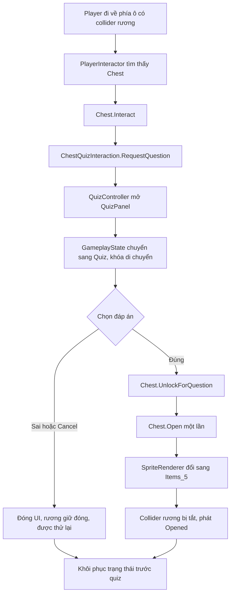

# Rương kho báu: chạm rương → câu hỏi → mở

> Player hiện di chuyển bằng vật lý: PlayerInteractor gọi Chest.Interact khi collider Player tiếp xúc collider rương và đang có input, không còn xét trước ô đích. Tham khảo [PLAYER_PHYSICS_MOVEMENT.md](PLAYER_PHYSICS_MOVEMENT.md). Cấu trúc Key/visual và luồng đáp án bên dưới giữ nguyên.

## Luồng được triển khai



“Chạm” ở đây là đi về phía ô có collider rương trong hệ thống di chuyển theo ô. Không cần phím E và không cần Player thực sự xuyên/chồng vào collider. Rương vẫn ở layer Obstacle, collider đặc; không bật Is Trigger để triển khai luồng này.

## Cấu trúc trong Hierarchy

```text
Key / TreasureChest        Empty gốc, scale (1,1,1)
├── BoxCollider2D           Layer Obstacle, Is Trigger tắt
├── Chest                   Opened Sprite = Items_5
├── ChestQuizInteraction    Question + Controller
└── visual
    └── SpriteRenderer      Sprite đóng Items_1; chỉnh scale hình riêng ở đây

ChestQuizSystem
├── QuizController
├── QuizCanvas
│   └── QuizPanel           Ban đầu inactive
│       ├── Question
│       ├── Answer 1
│       ├── Answer 2
│       ├── Answer 3
│       ├── Answer 4
│       ├── Feedback
│       └── Cancel
└── QuizEventSystem         Chỉ tạo nếu scene chưa có EventSystem
```

Nếu scene đã có QuizController, công cụ dùng controller đó và giữ UI hiện tại; cần kiểm tra nó đã có panel/đủ button. Công cụ không tạo một controller thứ hai. Nếu scene không có quiz, công cụ tạo UI cơ bản có bốn đáp án, dùng lại QuizPanel và QuizController của dự án.

## Thiết lập đã thực hiện cho scene đang mở

Editor/ChestSceneSetup.cs tìm rương dùng sprite Items_1 từ Art/Sprites/Item/Items.png trong Scene1 và thiết lập một lần trong phiên Unity khi có đúng một rương phù hợp. Nếu đang Play, chờ về Edit Mode. Thay đổi áp lên scene đang mở, hỗ trợ Ctrl+Z, không tự lưu hoặc ghi đè prefab gốc.

**Cần Ctrl+S để lưu cấu hình scene.** Source có trong project không thay thế việc lưu những object vừa tạo trong Hierarchy.

Câu hỏi mặc định là `Q_01_test_vocab_01`: “What is the meaning of 'happy'?”; đáp án đúng là “Feeling good”. Có thể đổi bằng cách kéo asset QuestionData khác vào ChestQuizInteraction.Question.

## Inspector của rương

| Component / trường | Gán gì? |
|---|---|
| SpriteRenderer.Sprite | Sprite rương đóng, hiện là Items_1 |
| BoxCollider2D | Vùng thân rương; enabled, Is Trigger tắt |
| GameObject.Layer | Obstacle |
| Chest.Chest Renderer | SpriteRenderer của chính rương |
| Chest.Opened Sprite | Items_5 trong Items.png |
| Chest.Open Chest Prefab | Để trống với cách đổi sprite tại chỗ này |
| Chest.Requires Quiz | Bật |
| Chest.Question Id | Công cụ gán; runtime đồng bộ theo question.id |
| ChestQuizInteraction.Question | Một asset QuestionData có ID và đáp án hợp lệ |
| ChestQuizInteraction.Controller | QuizController duy nhất của scene |
| ChestQuizInteraction.Retry Delay | Mặc định 0.5 giây, tránh gọi lại dồn dập sau sai/hủy |
| Player.GridMovement.Obstacle Mask | Có layer Obstacle |

Không gắn thêm QuizTrigger/MirrorTreasureItem trên chính rương hoặc cha của nó cho luồng này. QuizTrigger cũ dành cho điểm câu hỏi tách riêng, có hành vi tắt GameObject sau khi hoàn thành; ChestQuizInteraction mới giữ nguyên rương khi mở. Hai cách dùng chung QuizController/QuizPanel nhưng không nên đặt chồng lên một rương.

## Thêm rương mới

1. Thoát Play Mode, kéo sprite rương đóng vào scene, chỉnh vị trí và collider theo map.
2. Chọn object có SpriteRenderer đó.
3. Chọn **Tools → Chests → Setup Selected Chest with Quiz**. Có thể chọn Empty gốc Key có sprite con visual, hoặc object sprite kiểu cũ. Nếu chọn visual dưới Key có collider, công cụ tự dùng Key làm gốc. Chỉ chọn một rương, không chọn nhóm nhiều rương.
4. Đổi Question trong ChestQuizInteraction; công cụ giữ reference đã gán nếu chạy lại.
5. Lưu scene. Có thể kéo rương vào thư mục Gameplay/Items/Prefabs để tạo prefab riêng. Reference QuizController là theo scene, khi dùng prefab ở scene khác cần gán lại; runtime cũng có fallback QuizController.Instance.

Mọi rương dùng chung một UI/controller nhưng có Question và trạng thái mở riêng. Chỉ một phiên quiz được mở tại một thời điểm. Công cụ không tự thay sprite sheet, controller animation hoặc sprite asset.

Với cấu trúc Key/visual, script Chest và ChestQuizInteraction được gắn trên Key; Chest Renderer trỏ tới SpriteRenderer của visual. Giữ kích thước/offset collider trên Key do bạn chỉnh, không fit lại theo sprite con. Collider đặc cũ trên visual được tắt để tránh hai vùng chặn; trigger con được giữ. Nếu script rương cũ nằm trên visual, công cụ chuyển cấu hình sang Key và gỡ bản cũ, có Undo. Runtime Chest cũng tự tìm SpriteRenderer trong con khi chưa gán. Không cần đổi sprite sang UI Image.

## Kiểm tra sau khi lưu

1. Play, đi về phía rương: phải hiện câu hỏi và Player dừng nhận bước mới.
2. Chọn đáp án sai: UI đóng, rương giữ nguyên, có thể tiếp cận lại để thử.
3. Cancel: kết quả giống chưa hoàn thành, không mở rương.
4. Chọn “Feeling good” với câu hỏi mẫu: rương đổi sang Items_5, collider tắt và chỉ phát Opened một lần.
5. Di chuyển trở lại bình thường, không tự mở câu hỏi lần nữa trên rương đã mở.

QuizPanel hiện đóng ngay sau khi phản hồi, nên Feedback không được giữ lại lâu để đọc; đây là hành vi sẵn có của QuizController. Trạng thái rương chưa lưu qua lần thoát Play/chạy lại game. Chưa thêm tiền/vật phẩm thưởng: Chest.Opened là điểm nối nếu phát triển phần thưởng sau.

## File và kiểm tra

- Sửa Gameplay/Items/Scripts/Chest.cs: hỗ trợ sprite mở tại chỗ, chuyển tương tác sang quiz nếu có ChestQuizInteraction; giữ cách mở prefab/Animator cũ.
- Thêm Gameplay/Items/Scripts/ChestQuizInteraction.cs: điều phối câu hỏi cho rương; Chest vẫn giữ trạng thái khóa/mở.
- Thêm Editor/ChestSceneSetup.cs: cấu hình rương và tạo UI khi scene chưa có.
- Thêm test trong Tests/EditMode/GameplayRefactorTests.cs cho sai/hủy/đúng, đổi sprite và mở một lần.
- Đã biên dịch runtime, Editor và assembly test thành công. Log Unity xác nhận setup scene đã chạy. Chưa chạy Unity Test Runner hoặc thử tương tác thực tế bằng Play Mode trong lần triển khai này.
