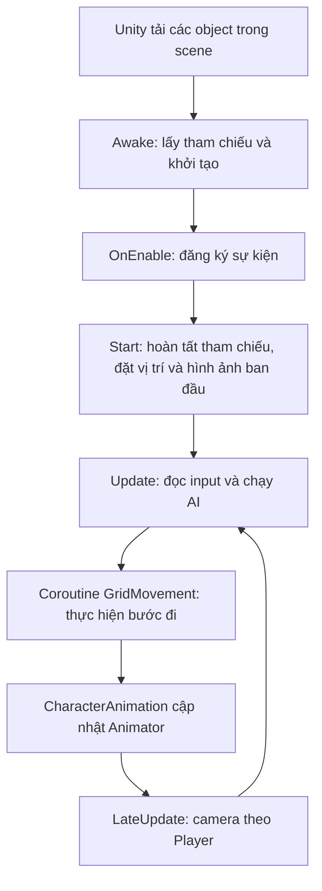
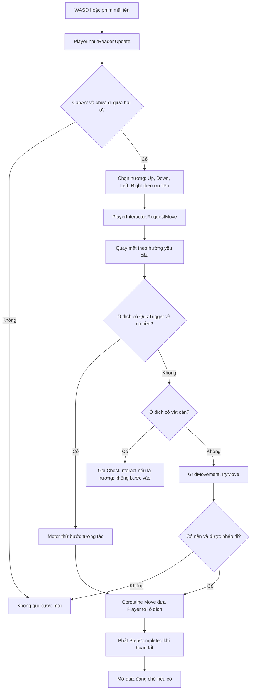
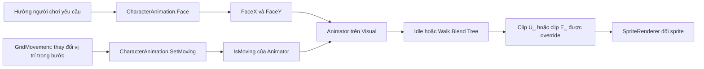
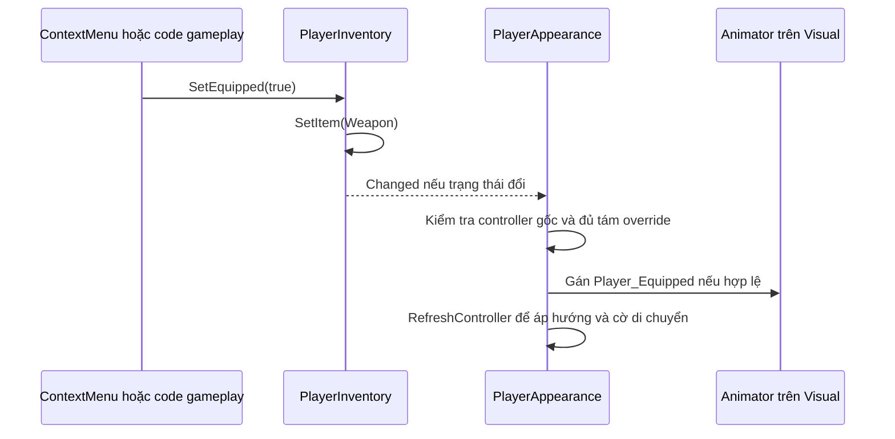
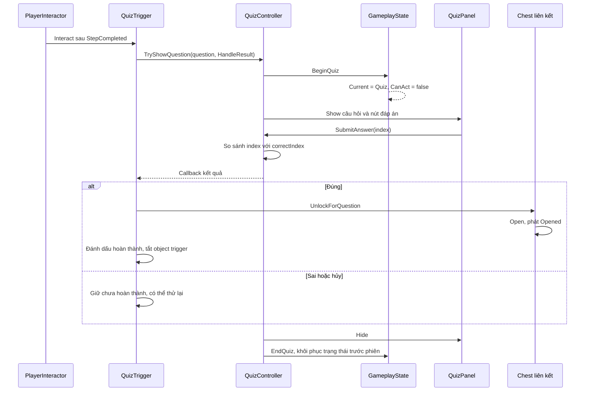

# Hiểu cấu trúc source và luồng hoạt động của project

> Cập nhật di chuyển: Player đã chuyển sang Rigidbody2D liên tục để collider chặn sát vật cản. Luồng hiện tại là PlayerInputReader → GridMovement.SetMovementInput → FixedUpdate/Physics2D; PlayerInteractor nhận tương tác khi tiếp xúc collider. Các mô tả bước ô/StepCompleted bên dưới là nhánh grid cũ còn giữ cho quái và tương thích. Đọc [PLAYER_PHYSICS_MOVEMENT.md](PLAYER_PHYSICS_MOVEMENT.md) cho hành vi Player hiện hành.

Tài liệu này giải thích theo code hiện có, dành cho việc đọc, chỉnh Inspector và phát triển tiếp. Các ví dụ scene thể hiện cách nối component; một chức năng có source chưa đồng nghĩa scene đang mở đã gắn đủ object để chạy chức năng đó.

## 1. Bắt đầu từ cách Unity chạy game

Một **Scene** chứa các **GameObject**. Mỗi GameObject có nhiều **Component**. Script kế thừa `MonoBehaviour` là component có thể gắn lên GameObject; Unity gọi các hàm vòng đời của nó.

| Khái niệm | Ví dụ trong project | Bạn thường làm gì? |
|---|---|---|
| Scene | `Scenes/Sence_1/Scene1.unity` | Bố trí map, nhân vật, camera |
| GameObject | Player, Visual, Main Camera, một cây | Chọn trong Hierarchy |
| Component | GridMovement, Animator, BoxCollider2D | Gắn script và chỉnh Inspector |
| Prefab | `Gameplay/Characters/Player/Prefabs/PLayer.prefab` | Lưu một object mẫu để tái sử dụng |
| ScriptableObject | QuestionData | Tạo asset dữ liệu câu hỏi, không gắn như MonoBehaviour |
| Animator Controller | `Art/Sprites/Player/Player_NoItem/Visual.controller` | Quyết định Idle/Walk và hướng |
| Animation Clip | U_Walk_Right, E_Walk_Right | Chứa sprite thay đổi theo thời gian |
| Editor script | PlayerSceneSetup, ChestSceneSetup | Tạo menu, hỗ trợ thiết lập trước khi chơi |

Ví dụ quan hệ trên Player:

```text
Player                         ← object có vị trí trên map
├── Transform
├── Rigidbody2D + Collider2D
├── PlayerMovement             ← adapter cũ, giữ tích hợp chết và dữ liệu tương thích
├── PlayerInputReader          ← đọc bàn phím
├── PlayerInteractor           ← xét tương tác ở ô đích
├── GridMovement               ← thực hiện bước đi
├── CharacterAnimation         ← cập nhật tham số animation
├── PlayerInventory            ← giữ trạng thái vật phẩm
├── PlayerAppearance           ← đổi bộ animation theo inventory
├── Health                     ← giữ máu
├── PlayerCollision            ← xử lý chạm quái
└── Visual                     ← phần hình ảnh, đi theo Transform của Player
    ├── SpriteRenderer
    └── Animator

Main Camera
└── PlayerCameraFollow2D        ← Target trỏ đến Player
```

Không cần một script duy nhất xử lý hết mọi thứ. Những component trên phối hợp bằng tham chiếu, lời gọi hàm và sự kiện.

## 2. Source được chia theo chức năng

Source riêng chủ yếu ở `Assets/_Project`. Những thư mục như Cainos và TextMesh Pro là tài nguyên/package bên thứ ba, không phải nơi thêm logic gameplay của project.

```text
Assets/_Project/
├── Core/Scripts/                       Trạng thái chung và camera
│   ├── GameplayState.cs
│   ├── PlayerCameraFollow2D.cs
│   └── MonsterFreezeController.cs      API tương thích cũ
├── Gameplay/
│   ├── Characters/
│   │   ├── Common/Scripts/             CharacterAnimation
│   │   ├── Player/Scripts/             Input, tương tác, inventory, ngoại hình...
│   │   ├── Player/Prefabs/             Prefab Player cũ
│   │   └── Enemies/                    AI, tấn công và prefab quái
│   ├── Grid/Scripts/                   GridMovement, SnapToGrid
│   ├── Combat/Scripts/                 Health, IDamageable
│   ├── Interaction/Scripts/            IInteractable, QuizTrigger, wrapper cũ
│   └── Items/                          Chest và prefab rương
├── Learning/Quiz/
│   ├── Scripts/                       Dữ liệu và điều phối câu hỏi
│   └── Data/                          Nơi lưu dữ liệu quiz theo cấu trúc dự án
├── UI/Quiz/                           Hiển thị panel, nút và phản hồi quiz
├── Editor/                            Menu thiết lập/migration, tạo dữ liệu
├── Tests/EditMode/                    Test kiểm tra logic
├── Art/                               Sprite, clip, controller và tài nguyên hình ảnh
├── Scenes/                            Scene1 và scene thử nghiệm
└── Docs/                              Hướng dẫn sử dụng và kiến trúc
```

**Quy tắc khi thêm code:** tìm chức năng tương ứng trước. Ví dụ thêm logic trang bị vào nhóm Player; thêm loại tương tác vào Interaction; thêm công cụ tạo collider vào Editor. Không tạo thêm một thư mục Scripts chung song song để chứa tất cả.

Các script runtime hiện dùng namespace toàn cục và assembly mặc định `Assembly-CSharp`. Script dưới thư mục Editor thuộc assembly Editor; chúng không chạy trong bản game build. Test có `.asmdef` riêng `DoAn.Refactor.EditModeTests`; dùng reflection để truy cập runtime trong assembly mặc định. Chưa có hệ thống assembly riêng cho từng nhóm Gameplay/Core.

## 3. Luồng tổng thể khi nhấn Play



Sơ đồ mô tả trách nhiệm, không phải thứ tự tuyệt đối giữa mọi component. Unity không đảm bảo mọi script cùng loại callback chạy theo thứ tự tên file. Coroutine chạy tiếp qua các frame; các hệ thống hoạt động xen kẽ trong vòng lặp game.

- `Awake`: PlayerMovement bổ sung component còn thiếu từ cấu hình cũ; các component lấy tham chiếu ban đầu.
- `OnEnable`: đăng ký sự kiện như StepCompleted, inventory Changed, Health.Died.
- `Start`: GridMovement đưa Player về tâm ô nếu có Tilemap; animation tìm Animator; appearance áp trạng thái trang bị ban đầu; camera focus vào target.
- `Update`: PlayerInputReader đọc phím nếu gameplay cho phép và chưa trong bước đi.
- `LateUpdate`: camera cập nhật sau chuyển động trong frame.
- `OnDisable`: gỡ các listener; motor dừng coroutine và xử lý lại trạng thái khi object bị tắt.

## 4. Luồng di chuyển: từ bàn phím đến vị trí



`TryMove` trả về false nếu yêu cầu bị từ chối. Nhánh tương tác quiz hiện được phép bỏ qua kiểm tra obstacle của motor nhưng vẫn yêu cầu nền; đây là quy tắc đã có cho việc bước lên item câu hỏi.

Ví dụ giữ D:

1. InputReader gửi hướng phải và tốc độ cho Interactor.
2. Interactor tính ô kế tiếp, kiểm tra quiz/rương/vật cản.
3. GridMovement lưu đích và bật IsMoving.
4. Mỗi frame, motor dùng `Vector3.MoveTowards` thay đổi Transform đến đích.
5. Trong bước này, input không được bắt đầu bước khác. Thả D vẫn hoàn thành bước hiện tại.
6. Đến đích, motor tắt IsMoving và phát StepCompleted. Nếu còn giữ D thì có thể bắt đầu bước tiếp theo.

**Ba đại lượng riêng biệt:**

| Đại lượng | Ở đâu? | Ý nghĩa |
|---|---|---|
| Speed | PlayerInputReader | World units mỗi giây |
| Grid Size | GridMovement | Khoảng cách mỗi bước |
| IsMoving của motor | GridMovement | Đang xử lý một bước, kể cả lúc bước đang bị Pause/Quiz giữ tiến độ |

Thời gian đi một ô xấp xỉ `Grid Size / Speed` khi không bị tạm dừng. Ví dụ ô 1, tốc độ 4 thì khoảng 0,25 giây/ô.

## 5. Kiểm tra nền và vật cản

`GridMovement.HasGround()` có hai cách xét nền:

1. **Ground có tile:** chỉ ô có tile được đi; lỗ trong Tilemap vẫn bị chặn.
2. **Ground rỗng hoặc chưa gán:** nếu gán Walkable Background, xét giới hạn XY của sprite đó.

Scene1 dùng ảnh MapBackground nên có thể dùng cách thứ hai. Hình nhà/cây vẽ trên ảnh không tự trở thành vật cản.

```text
Vật thể có Collider2D đang hoạt động
        + layer nằm trong Player/GridMovement.Obstacle Mask
        + collider giao vùng kiểm tra ở ô đích
        → motor không bước vào ô đó
```

Motor dùng OverlapBox 0.8 × 0.8 tại ô đích, chưa dùng kích thước collider Player để quét toàn đường đi. Bởi vậy đây là hệ thống chặn theo ô, không phải motor tự do dựa hoàn toàn vào va chạm Rigidbody2D. Vật thể rất nhỏ cần collider phủ vùng kiểm tra thích hợp.

Collider và layer vật cản được cấu hình thủ công trong Inspector. Khi game chạy, `GridMovement` và Physics2D dùng cấu hình đó. Công cụ tự tạo vật cản đã được gỡ.

## 6. Di chuyển và animation phối hợp thế nào?



`GridMovement` làm nhân vật đổi vị trí. Clip của bạn làm chân/tay đổi hình qua từng sprite. Camera chỉ thay đổi vị trí góc nhìn. Ba việc này do ba nơi khác nhau phụ trách.

| Hướng | FaceX | FaceY |
|---|---:|---:|
| Xuống | 0 | -1 |
| Trái | -1 | 0 |
| Phải | 1 | 0 |
| Lên | 0 | 1 |

Khi bị chặn, Interactor vẫn gọi Face nên nhân vật quay mặt nhưng không phát Walk do không có chuyển động. Khi dừng, CharacterAnimation giữ hướng cuối. Khi GameplayState không cho hành động, nó tắt cờ chạy của Animator. Controller quái cũ vẫn có thể dùng IsRunning/flipX nhờ nhánh tương thích trong CharacterAnimation.

**Không nhầm các tốc độ:** PlayerInputReader.Speed là tốc độ vị trí; state Walk Speed và tốc độ Motion là hệ số phát clip; Samples và vị trí keyframe quyết định nhịp sprite trong clip. Hiện chưa có code tự đồng bộ tốc độ Walk theo tốc độ Player.

## 7. Luồng trang bị và ngoại hình



PlayerInventory là nơi giữ None/Weapon. PlayerAppearance chỉ biểu diễn trạng thái này ra hình ảnh, không sở hữu một inventory thứ hai. `SetEquipped(false)` quay về controller gốc. Thiếu override thì cảnh báo một lần và dùng bộ chưa trang bị; inventory vẫn giữ trạng thái gameplay đã đặt.

Hiện Weapon đại diện cả bộ ngoại hình. Chưa có túi đồ nhiều ô, thay giày/kiếm/khiên độc lập hoặc logic nhặt vũ khí hoàn chỉnh. Mở rương chưa tự động gọi SetEquipped: cần nối phần thưởng qua Chest.Opened nếu phát triển tính năng đó.

## 8. Luồng quiz và mở rương

Rương chạm trực tiếp hiện còn có `ChestQuizInteraction` trong Gameplay/Items/Scripts: PlayerInteractor gặp collider rương → Chest.Interact → ChestQuizInteraction mở QuizController → đúng thì Chest đổi sprite Items_5 và mở một lần. Cách này không cần điểm QuizTrigger riêng và giữ rương trong scene. Chi tiết cấu hình và UI: [CHEST_QUIZ_SETUP.md](CHEST_QUIZ_SETUP.md). Luồng QuizTrigger bên dưới vẫn được giữ cho các điểm câu hỏi tách riêng.

| File | Giữ gì? | Làm gì? |
|---|---|---|
| QuestionData | Nội dung, đáp án, correctIndex, explanation, id | Dữ liệu dùng chung giữa các object |
| QuizTrigger | Câu hỏi và rương liên kết, cờ hoàn thành | Yêu cầu mở quiz, nhận kết quả của phiên mình mở |
| QuizController | Câu hỏi hiện tại, callback kết quả | Mở/đóng phiên và kiểm tra đáp án |
| QuizPanel | Text và Button | Hiện nội dung, gửi chỉ số đáp án |
| Chest | Khóa/mở và questionId | Chỉ mở khi điều kiện cho phép, phát Opened một lần |
| QuizEvents | Sự kiện opened/answered/closed | Cho các hệ thống khác quan sát |



Quiz không dùng Time.timeScale = 0. Các script gameplay tự kiểm tra CanAct. Khi quiz mở, Player/AI không bắt đầu bước mới; bước đang đi giữ tiến độ. UI tiếp tục hoạt động. Kết quả trả riêng về trigger đã mở phiên, không mở tất cả rương trùng ID qua event toàn cục.

**Lưu ý cấu hình:** trả lời đúng sẽ tắt GameObject của QuizTrigger. Nếu đặt cả rương làm con của trigger đó, rương cũng bị ẩn theo cha; cần bố trí liên kết/hierarchy đúng mục đích. Đây là hành vi hiện tại của source.

## 9. Trạng thái game, máu và quái

GameplayState giữ bốn trạng thái:

| Trạng thái | CanAct | Hành vi |
|---|---|---|
| Playing | true | Nhận input, AI chạy và cho phép xử lý chiến đấu |
| Quiz | false | Tạm giữ gameplay trong phiên câu hỏi |
| Paused | false | Tạm dừng theo API Pause/Resume |
| GameOver | false | Dừng gameplay sau khi Player chết |

GameplayState là class static, không gắn lên GameObject. Scene chưa chắc đã có UI Pause/GameOver; source hiện cung cấp trạng thái và API.

Luồng va chạm quái hiện có:

```text
PlayerCollision.OnTriggerEnter2D gặp object tag Monster
  → kiểm tra CanAct và Player còn sống
  → inventory có Weapon: Destroy object quái vừa chạm
  → không có Weapon: EnemyAttack.Attack hoặc gọi Health trực tiếp
  → Health giảm máu, phát Changed
  → máu hết: Health phát Died một lần
  → PlayerMovement.Die: GameplayState.GameOver + tắt Player
```

Luồng này dựa trên trigger; phải cấu hình tag/collider/physics phù hợp để callback xảy ra. Đây là xử lý chạm quái đã có, chưa phải hệ thống đánh kiếm với nút tấn công, hitbox và cooldown.

EnemyBrain quyết định tuần tra hoặc đuổi Player, rồi gửi bước đến GridMovement. Nó tìm bước theo các ô lân cận và khoảng cách, chưa dùng A*. EnemyAttack phụ trách lời gọi gây sát thương; Health chịu trách nhiệm tính máu. MonsterGridAI là tên wrapper cũ kế thừa EnemyBrain.

## 10. Camera

`PlayerCameraFollow2D` gắn trên Main Camera, Target trỏ đến Transform Player. Khi bắt đầu, Focus đặt XY camera vào Player; LateUpdate dùng SmoothDamp theo target, giữ Z và zoom hiện tại.

- Smooth Time = 0: theo ngay.
- Smooth Time lớn hơn: theo mềm hơn và có độ trễ.
- Zoom 2D chỉnh ở Camera.Orthographic Size, không phải Speed của Player.
- Camera hiện chưa giới hạn theo biên map nên đi gần mép có thể nhìn ra ngoài nền.

## 11. Công cụ Editor khác code chạy trong game thế nào?

| Công cụ | Menu/vai trò | Phạm vi |
|---|---|---|
| PlayerSceneSetup | Tools → Player → Setup Player in Current Scene | Thêm component thiếu, nối Animator/nền/ngoại hình/camera và mask cho Player |
| GameplayRefactorMigration | EarthDefender → Refactor | Migration nhiều scene/prefab và lưu asset; phạm vi rộng hơn setup scene hiện tại |
| QuestionDataSeeder | Tạo/cập nhật câu hỏi mẫu | Dữ liệu thử nghiệm |

PlayerSceneSetup và ChestSceneSetup hỗ trợ Undo, đánh dấu scene có thay đổi để bạn xem lại/lưu. Không cần gắn các script Editor này lên Player hay từng cây.

Không còn tự setup collider cho vật cản khi mở Unity. Bạn tự cấu hình collider/layer và lưu prefab để tái sử dụng.

## 12. Tại sao còn tên class hoặc thư mục cũ?

Unity tham chiếu script/asset bằng GUID trong file `.meta`, đồng thời lưu tên field và dữ liệu trong scene/prefab. Project giữ một số adapter/wrapper để dữ liệu và callback đã thiết lập tiếp tục hoạt động.

| Tên cũ còn giữ | Vai trò hiện tại |
|---|---|
| PlayerMovement | Adapter, giữ field cũ và xử lý Health/chết; chuyển động thực do GridMovement |
| MonsterGridAI | Wrapper của EnemyBrain |
| QuestionManager | Wrapper của QuizController |
| PanelController | Wrapper của QuizPanel, giữ callback Button cũ |
| MirrorTreasureItem | Wrapper của QuizTrigger |
| MonsterFreezeController | API tương thích, GameplayState quản lý việc giữ gameplay |
| Scripts/Player/NewMonoBehaviourScript | Script trống, chưa có hành vi gameplay |

Vì thế không gắn đồng thời wrapper và class cơ sở để thực hiện cùng một chức năng. Không xóa `.meta` hay đổi GUID chỉ để dọn tên. Không dùng field speed cũ trên PlayerMovement để chỉnh tốc độ khi PlayerInputReader đã được gắn và cấu hình riêng.

## 13. Muốn sửa gì thì mở đâu?

| Nhu cầu | Nơi xem/chỉnh trước |
|---|---|
| Phím điều khiển, ưu tiên hướng | PlayerInputReader.cs |
| Tốc độ đi | PlayerInputReader.Speed trong Inspector |
| Cách bước đi, nền, mask, khoảng cách ô | GridMovement.cs và Inspector của nó |
| Tương tác trước/sau khi bước | PlayerInteractor.cs |
| Nhân vật quay mặt hoặc Walk/Idle sai | CharacterAnimation.cs, Animator trên Visual và controller |
| Chân bước nhanh/chậm | Clip, keyframe/Samples, Walk Speed, Motion Speed |
| Mặc/tháo trang bị | PlayerInventory.SetEquipped và PlayerAppearance |
| Máu | Health.cs / Health Inspector |
| Player chết làm gì | PlayerMovement.Die |
| Chạm quái gây gì | PlayerCollision.cs, EnemyAttack.cs |
| Quái tuần tra/đuổi | EnemyBrain.cs |
| Nội dung/đáp án câu hỏi | Asset QuestionData |
| Kiểm tra đáp án | QuizController.SubmitAnswer |
| Giao diện câu hỏi | QuizPanel.cs và Canvas trong scene |
| Điều kiện mở rương/phần thưởng | Chest.cs và sự kiện Opened |
| Camera bám/zoom | PlayerCameraFollow2D và Camera Inspector |
| Thêm vật cản | Collider/layer của object và Obstacle Mask của Player |
| Tự gắn component vào scene | PlayerSceneSetup.cs |

## 14. Thứ tự đọc source gợi ý

1. Mở Hierarchy Player và đối chiếu sơ đồ ở mục 1.
2. Đọc PlayerInputReader → PlayerInteractor → GridMovement, theo dõi một lần nhấn D.
3. Đọc CharacterAnimation và xem Parameters trong Animator khi chơi.
4. Đọc PlayerInventory → PlayerAppearance, thử ContextMenu Equip/Unequip.
5. Đọc GameplayState → Health → PlayerCollision → PlayerMovement.Die.
6. Đọc QuestionData → QuizTrigger → QuizController → QuizPanel → Chest.
7. Sau khi hiểu runtime, đọc PlayerSceneSetup và ChestSceneSetup để biết chúng tạo cấu hình gì.

Bạn có thể đặt breakpoint hoặc log tạm ở RequestMove, TryMove và StepCompleted để quan sát yêu cầu đi → được chấp nhận/từ chối → hoàn tất. Tránh log liên tục trong Update khi chỉ cần biết một sự kiện.

## 15. Scene đang chỉnh và scene trong Build

Scene1 là scene map đang dùng trong cuộc trao đổi này. Tuy nhiên, tại thời điểm đối chiếu source, Build Settings vẫn bật `Scenes/Scene_Test/SampleScene.unity`. Vì vậy Play scene đang mở và chạy bản build có thể vào hai scene khác nhau. Khi chuẩn bị build, kiểm tra danh sách scene trong Build Profiles/Scene List.

Prefab PLayer cũ cũng có thể khác Player trong Scene1. Chỉnh một scene instance không tự cập nhật prefab gốc hoặc các scene khác. Khi tái sử dụng Player, cần chủ động kiểm tra prefab và những reference phụ thuộc scene như Ground, camera target.

Tài liệu thao tác liên quan: [thiết lập Player](PLAYER_CONTROLS_SETUP.md), [thiết lập vật cản](MAP_OBSTACLES_SETUP.md), [cấu trúc tổng quan](../../../PROJECT_STRUCTURE.md).
