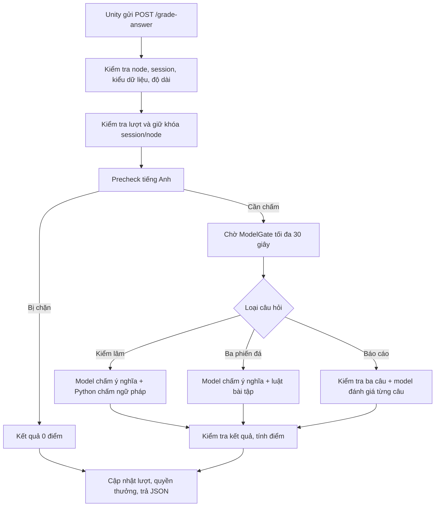

# Logic chấm điểm và xử lý lỗi của UnityAI

Ngày đối chiếu mã nguồn: **25/11/2026**.

Tài liệu mô tả code đang có trong dự án tại thời điểm đọc. Đây là bản giải thích luồng xử lý, không phải báo cáo chạy LLM thật hoặc cam kết bộ chấm nhận diện được mọi lỗi tiếng Anh. Tác vụ viết tài liệu này không thay đổi logic chấm.

## 1. Các file tham gia xử lý

Các đường dẫn dưới đây tính từ thư mục `UnityAI`.

| File | Trách nhiệm |
|---|---|
| [app.py](../app.py) | Flask API, kiểm tra request, quản lý lượt, chống gửi trùng, quyền thưởng, gọi bộ chấm. |
| [script/dialogue_loader.py](../script/dialogue_loader.py) | Đọc cặp hội thoại/cấu hình, kiểm tra dữ liệu, tạo `QuestionCtx` cho từng câu hỏi. |
| [script/dialogue_grading.py](../script/dialogue_grading.py) | Prompt kiểm lâm, phân loại mức liên quan, tiền kiểm tra, tính điểm chung, sửa câu theo luật. |
| [script/grammar_rules.py](../script/grammar_rules.py) | Registry 11 nhóm luật ngữ pháp và nhận diện thì bằng mẫu. |
| [script/verbs.py](../script/verbs.py) | Bảng động từ, dạng V-ing, ngôi thứ ba, quá khứ và phân từ. |
| [config/irregular_verbs.csv](../config/irregular_verbs.csv) | Dữ liệu động từ bất quy tắc `base,past,pp`. |
| [script/rules.py](../script/rules.py) | Chuẩn hóa dấu, đếm từ, nhận diện tiếng Việt/chuỗi khó hiểu và ý định hỏi đường. Xuất lại các hàm luật ngữ pháp. |
| [script/temple_grading.py](../script/temple_grading.py) | Kết hợp điểm model với yêu cầu bắt buộc của bài đền; quy đổi kết quả báo cáo thành điểm. |
| [script/temple_report.py](../script/temple_report.py) | Tách ba câu, dựng prompt báo cáo, kiểm tra cấu trúc kết quả model và điều kiện đạt. |
| [script/model.py](../script/model.py) | Nạp ONNX, dựng ChatML, sinh văn bản, parse JSON, thử lại khi kết quả không hợp lệ. |
| [script/model_gate.py](../script/model_gate.py) | Khóa dùng chung để chỉ một request chạy model tại một thời điểm. |
| [script/dialogue_intent.py](../script/dialogue_intent.py) | Prompt và kiểm tra kết quả nhận diện ý định hỏi vị trí di tích. |
| [script/eval_dialogue.py](../script/eval_dialogue.py) | Công cụ đánh giá offline; không phải đường đi của request trong game. |

## 2. Dữ liệu hội thoại và cấu hình

| Hội thoại | Nội dung | Cấu hình chấm |
|---|---|---|
| Kiểm lâm | [map2_forest_ranger.json](../config/dialogues/map2_forest_ranger.json) | [map2_forest_ranger.grading.json](../config/dialogues/map2_forest_ranger.grading.json) |
| Đền | [map2_ancient_temple.json](../config/dialogues/map2_ancient_temple.json) | [map2_ancient_temple.grading.json](../config/dialogues/map2_ancient_temple.grading.json) |

`DialogueStore` đọc các file JSON trong `config/dialogues`, bỏ qua file kết thúc bằng `.grading.json`, rồi tìm file cấu hình cùng tên. Có thể đổi thư mục bằng `DIALOGUE_DIR`.

Với mỗi node `type == "question"`, loader tạo một `QuestionCtx`. Dự án hiện có **7 node câu hỏi**: 3 kiểm lâm và 4 đền.

Các trường cấu hình quan trọng:

| Trường | Cách dùng |
|---|---|
| `scene_facts` | Bối cảnh cốt truyện gửi model. |
| `expected_intent`, `expect_hint_vi` | Nội dung câu trả lời cần đáp ứng và gợi ý khi thiếu ý. |
| `references` | Câu tham khảo; API dùng phần tử đầu khi hết lượt. Không mặc định bắt người chơi chép nguyên văn. |
| `story_examples`, `scene_examples`, `off_examples` | Ví dụ phân loại mức liên quan. |
| `scene_cap`, `scene_hint_vi` | Trần điểm ý nghĩa và gợi ý cho câu chỉ hợp bối cảnh. |
| `few_shot` | Ví dụ đầu vào/đầu ra cho bộ chấm ý nghĩa thông thường. |
| `target_forms`, `strict_form` | Công thức, các thì được chấp nhận, gợi ý và chế độ bắt buộc cấu trúc. |
| `min_words`, `pass_total`, `reward_total`, `max_attempts` | Số từ, ngưỡng đạt, ngưỡng thưởng và lượt trả lời. |
| `assessment_mode: temple_exercise`, `exercise_id` | Chuyển sang bộ chấm bài đền và nối với phần `exercises` trong JSON nội dung. |

Loader kiểm tra ID trùng, thiếu cấu hình, kiểu dữ liệu, khoảng điểm, ví dụ relevance và sự nhất quán giữa node với exercise. `max_attempts: null` được chấp nhận cho exercise có `retry_policy.mode == "until_pass"`; bài đền có thể đặt `min_words: 0`.

## 3. Luồng API chính



`POST /grade-answer` nhận `node_id`, `session_id`, `answer`. `session_id` là chuỗi do client gửi, không phải cơ chế xác thực.

- Câu thông thường và ba phiến đá: tối đa **300 ký tự**.
- Báo cáo đền không giới hạn lượt: tối đa **1.500 ký tự**.
- Node không tồn tại trả HTTP 404; payload sai hoặc vượt độ dài trả HTTP 400.
- Trùng request đang xử lý của cùng `(session_id, node_id)` hoặc không lấy được khóa model trả HTTP 503.
- JSON model không đạt sau các lần thử trả `review_required`; lỗi xử lý trả HTTP 500. Các trường hợp này không trừ lượt.
- Request `validated` mới cập nhật bộ đếm. Câu đền để trống bị trả 400, không tính lượt; câu kiểm lâm rỗng hoặc bị precheck chặn có thể nhận 0 điểm và tính một lượt.

Lượt và trạng thái thưởng lưu trong RAM bằng `OrderedDict`, với giới hạn đích 2.000 khóa; code tránh xóa khóa đang được xử lý. Khởi động lại server hoặc loại bỏ bản ghi cũ làm mất trạng thái đó. Nhiều worker sẽ có các bộ đếm RAM riêng.

## 4. Model, prompt và kiểm tra kết quả

`app.py` khởi tạo `DialogueStore` và `EnglishModel` khi nạp ứng dụng. Model mặc định nằm trong `models/qwen3-4b-instruct-2507-onnx-int4`; biến `MODEL_DIR` cho phép đổi đường dẫn.

`EnglishModel.request_json()` gọi sinh văn bản tối đa **2 lần**: lần đầu và một lần thử lại. JSON phải parse được và qua validator; kết quả chạm giới hạn token cũng bị từ chối. Thử lại không đồng nghĩa dùng thêm một lượt của người chơi.

| Nhánh | Giới hạn token đầu ra | Chế độ |
|---|---:|---|
| Kiểm lâm | 160 | Greedy, `sample=False` |
| Ba phiến đá | 200 | Greedy |
| Báo cáo | 700 | Greedy |
| Nhận diện hỏi đường | 30 | Greedy |

Prompt ý nghĩa thông thường gồm bối cảnh, tối đa 3 lời NPC trước đó, câu hỏi, mục tiêu, ví dụ relevance, scene cap và few-shot. `sanitize_answer()` loại một số token điều khiển, thẻ answer và ký tự điều khiển; đây không phải bộ lọc bảo đảm loại mọi prompt injection.

Model kiểm lâm/ba phiến đá trả `relevance`, `meaning`, `feedback_vi` và tùy chọn `better_answer`. Validator không cho model tự thêm `grammar` hay `errors`; điểm ngữ pháp ở nhánh này do Python quyết định.

## 5. Kiểm lâm: relevance và điểm ý nghĩa

| Relevance | Điểm sau xử lý |
|---|---|
| `off` | Bắt buộc bằng 0. |
| `scene` | Ít nhất 1; không vượt `scene_cap` nếu có, còn lại tối đa 5. |
| `story` | Ít nhất 1, tối đa 5. |

Model còn phải đánh giá câu có trả lời đúng câu hỏi hay không. Một câu liên quan cốt truyện vẫn có thể chỉ được 1–2 điểm nếu không trả lời điều NPC hỏi.

| Node | Min words | Scene cap | Lượt | Strict form |
|---|---:|---:|---:|---|
| `ranger_question_01_player_identity` | 2 | Không đặt | 3 | Không |
| `ranger_question_02_player_purpose` | 3 | 3 | 3 | Không |
| `ranger_question_03_creature_origin` | 3 | Không đặt | 3 | Không |

## 6. Ngữ pháp bằng luật Python

`grammar_rules.py` có 11 nhóm luật, dùng regex và bảng từ hữu hạn:

| Rule ID | Nhóm lỗi |
|---|---|
| `pres_cont.bare_verb` | Thiếu V-ing sau am/is/are trong các mẫu hỗ trợ. |
| `pres_perf.wrong_participle` | Sai have/has hoặc phân từ; có hỗ trợ một số chủ ngữ danh từ và V1 sau have/has. |
| `past.v1_with_past_marker` | Dùng V1 với mốc quá khứ trong các mẫu hỗ trợ. |
| `be.agreement` | Sai am/is/are với chủ ngữ hỗ trợ. |
| `do.agreement` | Sai do/does và một số dạng động từ sau trợ động từ. |
| `pres_cont.missing_aux` | Thiếu am/is/are trước V-ing. |
| `article.role_noun` | Thiếu a/an trước danh từ vai trò số ít. |
| `article.bare_object` | Thiếu từ hạn định trước một số tân ngữ đếm được số ít. |
| `plural.after_number` | Thiếu số nhiều sau số đếm hoặc many/several. |
| `future.will_not_base` | Sai dạng động từ sau will. |
| `sv.third_person_base` | Một số lỗi chia động từ hiện tại đơn với đại từ. |

Các rule được xét theo thứ tự ưu tiên. Những đoạn khớp chồng lấn không được tính lặp; kết quả được sắp theo vị trí trong câu và chỉ giữ **tối đa 3 lỗi**. `_positioned_errors()` xác định vị trí sửa, `apply_fixes()` thay từ cuối câu về đầu để không làm lệch các vị trí còn lại.

### Điểm ngữ pháp chung

| Số lỗi được giữ lại | Điểm cơ sở |
|---:|---:|
| 0 | 5/5 |
| 1 | 4/5 |
| 2 | 3/5 |
| 3 | 2/5 |

- Dưới `min_words`: điểm ngữ pháp bị chặn tối đa 3/5; lý do được đưa vào `grammar_notes`.
- Chưa khớp thì mục tiêu: thêm `form_hint_vi`.
- Nếu `strict_form=True`, chưa khớp thì mục tiêu còn chặn điểm ngữ pháp tối đa 4/5 và thêm lý do vào `grammar_notes`.
- `detect_tenses()` dùng dấu hiệu bề mặt, không phân tích toàn bộ cú pháp. Nó nhận diện 5 nhóm thì và mặc định hiện tại đơn khi không tìm được dấu hiệu khác.

Vì vậy, **4/5 không có nghĩa câu hoàn toàn đúng**: đó có thể là một lỗi được tìm thấy hoặc một mức trần do chưa dùng đúng cấu trúc bắt buộc.

Ví dụ hồi quy từ câu người dùng đã báo:

```text
Gốc: The creatures have destroy animal
Lỗi 1: The creatures have destroy → The creatures have destroyed
Lỗi 2: animal → an animal
Sửa: The creatures have destroyed an animal
Điểm ngữ pháp: 3/5
```

Điểm ý nghĩa của ví dụ vẫn phụ thuộc câu NPC hỏi và kết quả model; không thể kết luận tổng điểm chỉ từ hai lỗi này.

### Câu sửa và câu gợi ý

- `corrected_answer`: chỉ áp dụng các sửa đổi có vị trí cụ thể từ luật.
- `better_answer`: câu gợi ý riêng do model viết, có thể thêm chi tiết cốt truyện; không phải bằng chứng mọi phần khác biệt đều là lỗi.
- Câu gợi ý bị ẩn nếu rỗng, trùng câu gốc khi bỏ khác biệt hoa/thường, quá 30 từ, bị nhận diện tiếng Việt hoặc vi phạm luật đã biết.
- Việc lọc này không chứng minh câu gợi ý hoàn toàn đúng ngữ pháp hay đúng mọi chi tiết thực tế.

## 7. Tổng điểm, đạt và thưởng

Với kiểm lâm, cấu hình hiện tại:

```text
total_score = meaning + grammar
passed = total_score >= 6 AND meaning >= 3
reward_eligible = total_score >= 8 AND meaning >= 4
```

Một câu còn lỗi ngữ pháp vẫn có thể đạt nếu tổng điểm và ý nghĩa đủ ngưỡng. Đây là logic hiện có, không phải lỗi hiển thị.

`reward_eligible` là điều kiện về điểm. API còn kiểm tra trạng thái đã thưởng để tạo `can_award_reward`; game phải dùng cờ ngoài cùng này nếu trao thưởng. Với bài đền, bộ chấm luôn đặt `reward_eligible=False`.

## 8. Ba bài phiến đá của đền

Ba bài đều gọi model chấm relevance/ý nghĩa qua `/grade-answer`, đồng thời chạy `check_local()` để kiểm tra yêu cầu bắt buộc.

| Node | Yêu cầu | Lượt | Min words |
|---|---|---:|---:|
| `temple_03_first_stone` | Chuyển câu về quá khứ đơn khẳng định. | 2 | 3 |
| `temple_05_second_stone` | Chuyển câu về hiện tại hoàn thành. | 2 | 3 |
| `temple_07_third_stone` | Đáp án đọc hiểu có từ đầy đủ `portal` hoặc `crater`. | 2 | 1 |

Hai bài chuyển thì loại câu hỏi có `?` và bài không đúng một câu trước khi chuẩn hóa; sau đó kiểm tra từ cấm, đáp án được chấp nhận hoặc toàn bộ pattern và token bắt buộc. Có đủ từ khóa không đồng nghĩa đáp án đúng. Pattern cố ý giới hạn các cách diễn đạt được hỗ trợ.

Bài đọc hiểu dùng ranh giới từ: `portal` khớp, `portals` không tự khớp. Không đòi câu đầy đủ và không đánh giá ngữ pháp. Backend gán thành phần ngữ pháp 5 điểm để không trừ điểm, đồng thời trả `grammar_not_assessed=True`; UI phải ghi rõ đây không phải kết quả kiểm tra ngữ pháp.

Điều kiện qua ba bài:

```text
passed = exercise_requirement_met AND meaning >= 3 AND total_score >= pass_total
```

Vì vậy, model cho điểm cao vẫn không vượt qua được luật bài tập. Scene cap hiện tại của ba bài là 2. Sau hai lượt sai, backend không đổi kết quả thành đúng; Unity cho đọc đáp án và tiếp tục để không khóa phần tư liệu.

## 9. Báo cáo ba câu ở đền

Node: `temple_09_report`. Không giới hạn lượt, không đặt số từ tối thiểu; tối đa 1.500 ký tự qua API chung.

| Câu | Vai trò | Thì yêu cầu |
|---:|---|---|
| 1 | Điều đã thấy hoặc biết ở đền. | Quá khứ đơn |
| 2 | Thiệt hại các sinh vật đã gây ra cho rừng. | Hiện tại hoàn thành |
| 3 | Dự định đến hố đất và đóng cổng. | Tương lai đơn |

`split_sentences()` tách theo chuỗi dấu `.`, `!`, `?`, giữ đoạn cuối không có dấu chấm, bảo vệ một số chữ viết tắt và số thập phân. Chỉ xuống dòng không tạo câu mới. Đây vẫn là bộ tách câu đơn giản.

Trước suy luận, báo cáo phải qua precheck tiếng Anh và có đúng 3 câu. Nếu không đạt, bộ chấm trả kết quả chưa đạt, không gọi model để suy luận.

Model nhận đề, dàn ý ba câu, các sự kiện đã cung cấp, bài tham khảo, bài ví dụ khác và câu trả lời người chơi. Model trả:

- `relevance`, `meaning_clear`, `feedback_vi`.
- Đúng 3 `sentence_checks`, đánh số 1–3, mỗi mục có `role_met`, `required_tense_met`, `feedback_vi`.
- `plot_contradictions` và `errors` theo từng câu.

Validator kiểm tra đầy đủ kiểu và cấu trúc, không tin một cờ `passed` do model tự thêm.

### Điều kiện đạt và quy đổi điểm

`finalize_report()` yêu cầu relevance là story, nghĩa rõ, không mâu thuẫn cốt truyện, đủ vai trò và đúng thì của cả ba câu. Chỉ cho phép các mã lỗi nhỏ `article`, `punctuation`, `minor_article`, `minor_punctuation` nếu các điều kiện khác đều đạt.

Nhánh báo cáo không dùng trực tiếp thang điểm kiểm lâm. `score_report()` quy đổi:

```text
roles = số câu có role_met=True
meaning = 0                          nếu off
meaning = min(2, roles)              nếu scene
meaning = min(5, roles + 2)          nếu story
meaning = min(meaning, 2)           nếu nghĩa không rõ hoặc có mâu thuẫn

grammar = max(0, 5 - số lỗi từ luật - số câu có vấn đề bổ sung)
passed = kết quả đạt của finalize_report AND total_score >= pass_total
```

Vấn đề bổ sung gồm thì bắt buộc chưa đạt và mã lỗi ngữ pháp model phát hiện. Code gộp chúng theo số câu và không trừ thêm nếu câu đó đã có sửa lỗi từ luật. Mọi thông báo model liên quan vẫn được đưa vào `grammar_notes`.

Đây là cơ chế tránh phạt trùng theo câu, không phải phép ghép lỗi hoàn chỉnh theo vị trí: nó có thể gộp cả những lỗi khác nhau trong cùng một câu. `corrected_answer` của báo cáo chỉ sửa lỗi từ luật; model không cung cấp replacement đầy đủ trong hợp đồng báo cáo.

`scene_cap` và `few_shot` chung trong cấu hình báo cáo không được áp dụng theo đường `finalize_dialogue_grade()`: báo cáo đi nhánh chuyên biệt vừa mô tả.

## 10. Trạng thái trả về và hiển thị trong Unity

| Trường | Ý nghĩa |
|---|---|
| `scores.meaning`, `scores.grammar`, `total_score`, `max_score` | Điểm sau khi backend xử lý. |
| `errors` | Các lỗi có quote, replacement và giải thích để sửa câu. |
| `grammar_notes` | Lý do trừ điểm/yêu cầu cần sửa nhưng không nhất thiết có replacement trực tiếp. |
| `grammar_not_assessed` | Bài không đánh giá ngữ pháp, hiện dùng cho đọc hiểu phiến đá. |
| `corrected_answer`, `better_answer` | Câu sửa tối thiểu và câu gợi ý riêng. |
| `form_hint_vi` | Gợi ý công thức/thì mục tiêu. |
| `attempt`, `attempts_left`, `unlimited_attempts` | Lượt đã dùng, lượt còn lại; không giới hạn dùng `-1` kèm cờ true. |
| `passed`, `can_award_reward` | Quyết định qua bài và quyền thưởng cuối cùng. |

Unity nhận dữ liệu trong [UnityAiDialogueResponse.cs](../../Assets/_Project/Learning/Quiz/Scripts/UnityAiDialogueResponse.cs). Phần “Cần sửa” hiển thị lỗi cụ thể, `grammar_notes` và câu sửa nếu khác câu gốc. Nếu điểm bị giảm nhưng phản hồi cũ không có chi tiết, UI dùng gợi ý cấu trúc hoặc nhận xét; không kết luận không có lỗi.

`NpcJsonDialoguePanel` gửi cả kiểm lâm và đền đến `/grade-answer`. Với báo cáo không giới hạn lượt, `attempts_left=-1` không được hiểu là hết lượt. Ba phiến đá có thể tiếp tục sau khi hết hai lượt nhưng báo cáo chỉ tiếp tục khi đạt.

## 11. Những endpoint khác

- `GET /health`: xác nhận ứng dụng đã nạp model và trả số node câu hỏi.
- `GET /metrics`: do Prometheus exporter cung cấp.
- `POST /detect-intent`: luật trả yes/no/maybe cho ý định hỏi vị trí di tích; chỉ gọi model nếu maybe. Không tiêu lượt chấm bài. Unity tự kiểm soát thời điểm được mở nhánh ẩn.
- `POST /grade-temple-report`: endpoint báo cáo riêng còn tồn tại. Không quản lý session/lượt và không trả bộ điểm chuẩn hóa như API chung; dùng nội dung báo cáo trực tiếp qua `load_task()`. Unity hiện dùng API chung cho bài đền.
- Không có endpoint `/generate-question` trong `app.py` hiện tại.

## 12. Giới hạn và điểm cần lưu ý khi bảo trì

1. Luật ngữ pháp dựa trên regex và danh sách từ; câu ngoài mẫu có thể bị bỏ sót. Không có lỗi từ luật không chứng minh câu hoàn toàn đúng.
2. Mỗi lần trả tối đa 3 lỗi từ registry; đây không phải kiểm kê toàn bộ lỗi của một đoạn văn dài.
3. Đếm từ, phát hiện ngôn ngữ, chuỗi khó hiểu và nhận diện thì đều là heuristic. Ví dụ tên riêng hoặc cấu trúc phức tạp có thể cần ca kiểm thử riêng.
4. Kiểm lâm dùng model chấm ý nghĩa, không dùng model như một bộ phát hiện ngữ pháp tổng quát. Báo cáo mới có kiểm tra thì/ngữ pháp từ model bổ sung.
5. Model có thể đánh giá thiếu chính xác dù JSON hợp lệ. Validator chỉ kiểm tra hợp đồng và điều kiện quyết định, không chứng minh nhận xét của model là đúng.
6. `report_pass_conditions` đang có trong file grading nhưng loader chưa đưa trường này vào bộ quyết định; điều kiện đạt thực tế được viết trong `finalize_report()`. `report_model_instruction` thì có được loader áp dụng.
7. `eval_dialogue.py --compare-few-shot` thay biến `DISABLE_FEW_SHOT`, nhưng `build_user_prompt()` hiện luôn duyệt `ctx.few_shot`, không đọc biến này. Do đó không nên coi hai lượt so sánh hiện tại là bằng chứng đã bật/tắt few-shot đúng.
8. Các JSON `eval_*_report.json` là kết quả lưu từ những lần chạy trước, có thể thuộc phiên bản chấm khác. Không dùng chúng để khẳng định độ chính xác hiện tại khi chưa chạy lại.
9. Khởi động lại Flask để nạp thay đổi cấu hình vào `DialogueStore`; sửa file trong lúc server đã chạy không tự cập nhật tất cả context đang giữ trong RAM.

## 13. Vị trí kiểm thử và cách dò một lỗi

| Bộ test | Nội dung |
|---|---|
| `tests/test_rules.py` | Luật phát hiện/sửa lỗi và các ca tránh bắt nhầm. |
| `tests/test_finalize.py` | Điểm ngữ pháp, relevance, giới hạn điểm, lý do trừ điểm, câu sửa; có câu `The creatures have destroy animal`. |
| `tests/test_temple_grading.py` | Luật bắt buộc của đền, điểm báo cáo và hiển thị lỗi từ model. |
| `tests/test_temple_report.py` | Hợp đồng báo cáo, API với model giả, lượt và lỗi dịch vụ. |
| `tests/test_precheck.py`, `tests/test_tenses.py` | Tiền kiểm tra và nhận diện thì. |
| `tests/test_meaning.py`, `tests/test_contract.py`, `tests/test_evaluation.py`, `script/test_dialogue.py` | Các kiểm tra bổ sung về hợp đồng, dữ liệu và evaluator; cần đối chiếu với schema hiện tại khi thay cấu trúc. |

Khi tái hiện lỗi, lưu `node_id`, câu trả lời nguyên văn và JSON API. Đọc lần lượt `scores`, `errors`, `grammar_notes`, `corrected_answer`, `form_hint_vi`, `exercise_requirement_met` hoặc `report_checks`, rồi mới đối chiếu giao diện. Phải phân biệt model không phát hiện, luật không hỗ trợ, điểm bị chặn do yêu cầu bài và UI không hiển thị trường đã nhận.

Tác vụ này chỉ đọc code và viết tài liệu; không chạy server, LLM hoặc evaluator. Các con số kiểm thử được báo ở các tác vụ trước không được xem là một lần xác minh mới trong tài liệu này.
